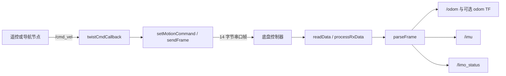

# limo_base 代码解析（ROS 2 Foxy）

本包把 ROS 2 速度指令转换成 LIMO 串口协议，并把底盘返回的数据发布为里程计、IMU 和车辆状态。它是上层导航与底盘控制器之间的驱动层，不负责地图、定位或路径规划。

分析日期：2026-11-24。本文基于仓库当前源码静态分析；没有在本次文档编写中编译、启动驱动或验证车辆运动。文中参数和话题描述的是实现，不能直接当成实车验收结果。

2026-11-28 更新：局部里程计可通过上层统一入口选择 `raw` / `ekf`。
本次修正了话题参数、测量方差和原航向积分的初始化/跨界问题；方案与验证方法见
[局部里程计说明](../limo_bringup/LOCAL_ODOMETRY.md)。其他未标记修复的问题仍属历史静态分析。

## 1. 文件与构建入口

| 文件 | 职责 |
| --- | --- |
| [package.xml](package.xml) | 定义 `limo_base` 包及 ament 依赖 |
| [CMakeLists.txt](CMakeLists.txt) | 用三个 C++ 文件构建可执行程序 `limo_base`，安装到 `lib/limo_base`，同时安装头文件和 `launch/` |
| [limo_base_node.cpp](src/limo_base_node.cpp) | 初始化 ROS 2，创建 `LimoDriver("limo_base")`，进入 `rclcpp::spin` |
| [limo_driver.h](include/limo_base/limo_driver.h) | 驱动类、串口线程、发布订阅接口、底盘几何常量 |
| [limo_driver.cpp](src/limo_driver.cpp) | 参数读取、串口收发、协议解析、运动模型、ROS 消息发布 |
| [limo_protocol.h](include/limo_base/limo_protocol.h) | 帧格式、报文 ID、接收状态机和运动模式编号 |
| [serial_port.h](include/limo_base/serial_port.h)、[serial_port.cpp](src/serial_port.cpp) | Linux `termios` 串口打开、配置、逐字节读取和写入 |
| [limo_base.launch.py](launch/limo_base.launch.py) | 本包主要启动入口，向驱动传入参数 |
| [open_ydlidar_launch.py](launch/open_ydlidar_launch.py) | 附带的雷达启动入口，调用外部雷达包及 TF；不启动本包底盘节点 |

`main` 中 `rclcpp::Rate(100)` 和 `sleep()` 位于 `spin()` 返回之后，不能理解为底盘以 100 Hz 周期发布。发布主要由接收到的反馈帧触发；`run()` 函数当前没有执行逻辑。

## 2. 启动和数据流



构造函数按以下顺序工作：

1. 声明和读取部分参数，创建 TF 广播器、三个发布器及速度订阅器。
2. 若串口名包含 `tty` 或以 `/dev/` 开头，以 `B460800` 打开串口；短名补上 `/dev/`。
3. `connect()` 启动 `readData()` 接收线程。
4. `enableCommandedMode()` 发送 `0x421` 报文，把首个数据字节置为 `0x01`，请求进入指令控制模式。

启动本包就会访问硬件并发送控制模式配置，不能把它作为纯离线查看节点使用。底盘模式以反馈数据为准；`use_mcnamu` 只改变驱动解释方式，不会替代车辆机械结构和模式设置。

## 3. 参数：启动文件和驱动并不完全对应

| 参数 | 启动文件默认值 | 实际读取或行为 |
| --- | --- | --- |
| `port_name` | `ttyTHS0` | 驱动后备值是 `ttyTHS1`；支持短名或完整 `/dev/...` |
| `odom_frame` | `odom` | 用作里程计及动态 TF 的父坐标系 |
| `base_frame` | `base_link` | 用作里程计及动态 TF 的子坐标系 |
| `pub_odom_tf` | `True` | 决定是否广播 `odom_frame → base_frame` |
| `use_mcnamu` | `False` | 为真时固定采用麦克纳姆模式，忽略系统状态帧中的运动模式更新 |
| `control_rate` | `50` | 驱动声明了该参数，但没有读取它来调度控制循环 |
| `odom_topic_name` | `odom` | 驱动实际使用的里程计输出；上层 EKF 方案设为 `/odom/raw` |
| `twist_linear_variance` | `0.0025` | 速度协方差，单位 `(m/s)^2` |
| `twist_angular_variance` | `0.0025` | 底盘角速度协方差，单位 `(rad/s)^2` |
| `imu_angular_velocity_variance` | `0.0004` | IMU 角速度协方差，单位 `(rad/s)^2` |

完整设备路径现在不会重复拼接 `/dev/`，也可用于虚拟串口测试。测量方差必须为有限正数；当前默认值尚未经过实车噪声标定。

布尔后备值已改为真正的 `false`，不再使用会转成 `true` 的字符串指针。

## 4. ROS 接口与坐标系

| 方向 | 接口 | 类型与含义 |
| --- | --- | --- |
| 订阅 | `/cmd_vel` | `geometry_msgs/msg/Twist`，读取 `linear.x`、`angular.z`，麦克纳姆模式还读取 `linear.y` |
| 发布 | `/odom` | `nav_msgs/msg/Odometry`，底盘速度和积分得到的位置姿态 |
| 发布 | `/imu` | `sensor_msgs/msg/Imu`，加速度、角速度和由 yaw 生成的姿态 |
| 发布 | `/limo_status` | `limo_msgs/msg/LimoStatus`，电压、控制模式、故障位和运动模式；详见 [limo_msgs 解析](../limo_msgs/代码解析.md) |
| TF | `odom_frame → base_frame` | `pub_odom_tf` 为真时发送，通常为 `odom → base_link` |

`/imu`、`/limo_status`、`/cmd_vel` 仍使用绝对话题。里程计按 `odom_topic_name` 发布，也可使用 ROS remapping。

`/imu` 的 `frame_id` 固定为 `imu_link`，但本包不发布 `base_link → imu_link` 的静态 TF，也不提供 `map → odom` 或雷达数据。前者由整车启动配置补齐，后者由定位、雷达等外部节点提供。

## 5. 串口帧怎样编码和解析

协议由 [limo_protocol.h](include/limo_base/limo_protocol.h) 与 `sendFrame()`、`processRxData()` 共同定义：

```text
字节 0       1       2–3         4–11       12      13
    0x55    0x0E    报文 ID      8 字节数据  计数    校验
```

多字节 ID 和运动数据按高字节在前组合。校验是 8 个数据字节求和后取低 8 位，不包含帧头、长度、ID 和计数字节。发送数组初始化为零，源码没有单独递增第 12 字节的计数值。

| ID | 处理 |
| --- | --- |
| `0x111` | 运动命令；四个 `int16` 值依次为前向速度、角速度、横向速度、转向角，发送前乘 1000 |
| `0x211` | 系统状态，解析电池电压（原始值乘 0.1）、故障位和运动模式 |
| `0x221` | 运动反馈，四个有符号值除 1000，触发里程计更新 |
| `0x311` | 左右轮里程数据被读取到局部变量，当前没有继续用于里程计计算 |
| `0x321` | 加速度反馈，各轴原始值除 100 |
| `0x322` | 角速度反馈，原始值除 100 后按角度转弧度 |
| `0x323` | 欧拉角反馈，更新 yaw/pitch/roll 并触发 IMU 发布 |
| `0x421` | 请求指令控制模式 |

执行器高速和低速状态 ID 虽有定义及 `case`，当前分支为空。不要据此认为电机级诊断信息已经发布。

## 6. 三种运动模式

`twistCmdCallback()` 根据 `motion_mode_` 选择分支：

- **四轮差速 `0x00`**：把 `linear.x` 和 `angular.z` 作为前向速度、角速度发送，横向速度与转向角置零。
- **阿克曼 `0x01`**：由 `r = linear.x / angular.z` 计算转弯半径，再转换为中心转角、内轮转角；内轮角限幅到约 ±28°，最后按标定比例换算后发送。
- **麦克纳姆 `0x02`**：发送 `linear.x`、`angular.z` 和 `linear.y`。

几何参数写在头文件中：轮距 `0.172 m`、轴距 `0.2 m`、左右转角比例均为 `2.47`。它们不是当前 launch 可动态调整的参数。

阿克曼分支没有完整处理速度和角速度同时为零的情况，也没有通用的非有限值检查。两个转向符号分支都使用 `right_angle_scale_`；当前左右比例相同，但将来分开标定时会受影响。头文件对 `setMotionCommand` 的参数命名与定义顺序存在误导，理解时以定义和调用中“前向、角速度、横向、转向角”的实际顺序为准。

## 7. 里程计与 IMU 的真实实现

`publishIMUData()` 把最近收到的加速度和角速度装入消息，只用 yaw 构建四元数，反馈的 roll 和 pitch 没有进入姿态四元数。加速度、角速度和欧拉角来自不同帧，当前没有按共同时间戳配对。

`publishOdometry()` 按反馈速度得到车体坐标系的 `vx`、`vy`、`wz`，计算相邻反馈帧的 `dt`。位置积分使用：

```text
rad = degToRad(real_theta_)
x += (cos(rad) * vx - sin(rad) * vy) * dt
y += (sin(rad) * vx + cos(rad) * vy) * dt
```

`real_theta_` 来自 IMU yaw 差值的累加，不是 `wz * dt` 的积分。因此它不是“只靠左右轮编码器积分”的里程计。EKF 方案只订阅这里的速度，不把该位姿再次作为独立测量融合。

当前需要重点核实的实现问题：

| 位置 | 源码可直接确认的情况 | 影响与检查方向 |
| --- | --- | --- |
| `publishIMUData`、头文件 | 已初始化航向与 IMU 成员，首帧仅设置起始 yaw | 不再从不确定值开始积分 |
| yaw 差值 | 已保留小增量，并归一化 ±180° 跨界 | 慢转不会因逐帧阈值而被忽略 |
| `motion_mode_` | 初始为差速，随后按状态帧或强制麦轮参数更新 | 不再读取未初始化模式 |
| `publishLimoState` | 使用 `rclcpp::Time(stamp)`，其整数构造按纳秒解释；其他路径使用秒转纳秒或当前时间 | `/limo_status` 时间戳可能与 `/imu`、`/odom` 不一致 |
| 时间来源 | `dt` 使用接收帧时间；TF 与 odom 消息又使用发布时的当前时间 | 传输延迟、回放和时间跳变时需要核查时间一致性 |
| 接收线程 | 析构为空，没有线程 `join()` 和清晰的停止流程；串口采用阻塞读取 | 退出时的线程和串口资源行为需要专项验证 |
| 速度命令 | 无驱动层命令超时停止、通用限速和写入返回值检查 | 不能仅凭本包源码推断失联后一定停车或命令一定完整写出 |

前三项已随局部里程计接入修复；其余仍是需要专项验证的原有实现问题。

## 8. 构建、检查与学习建议

本包依赖 ROS 2 Foxy、`rclcpp`、`nav_msgs`、`geometry_msgs`、`sensor_msgs`、TF2 以及同仓库 `limo_msgs`。现已补齐 `sensor_msgs`、`tf2_geometry_msgs` 的声明和相关构建依赖。

在 ROS 2 环境和依赖已准备好的情况下，可于仓库的 `ros2/` 目录构建核心驱动及其依赖：

```bash
source /opt/ros/foxy/setup.bash
colcon build --packages-up-to limo_base
source install/setup.bash
ros2 pkg prefix limo_base
ros2 pkg executables limo_base
```

只有确认当前会话应接管串口、没有另一套驱动占用设备、车辆已准备好时，才考虑启动：

```bash
ros2 launch limo_base limo_base.launch.py port_name:=ttyTHS0
```

运行后可以用以下只读检查观察接口；ROS 2 域设置需与目标系统一致：

```bash
ros2 node info /limo_base
ros2 param list /limo_base
ros2 param get /limo_base pub_odom_tf
ros2 topic info /cmd_vel -v
ros2 topic echo /limo_status
ros2 topic hz /odom
ros2 run tf2_ros tf2_echo odom base_link
```

先检查串口、系统状态和静止姿态，再检查动态 TF 与里程计；最后才接入导航。涉及雷达、定位和整车启动的部分继续阅读 [limo_bringup 解析](../limo_bringup/代码解析.md)。

返回[代码包解析总览](../../../../docs/01-项目与开发/代码包解析总览.md)。
