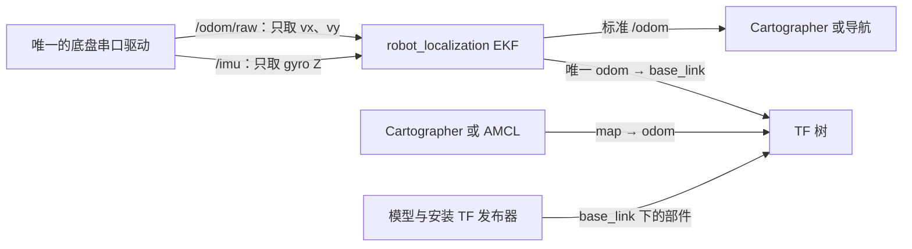

# 局部里程计：一个入口，按配置选择算法

`limo_start.launch.py` 统一启动一套底盘、雷达和传感器安装 TF，并从
[`param/local_odometry.yaml`](param/local_odometry.yaml) 选择一个局部里程计方案。
目前注册 `raw`、`ekf`，不需要为这两种方案分别维护启动文件。

## 启动与切换

在已加载 ROS 2 Foxy 和工作区环境的终端中，二选一：

```bash
# 原车里程计：底盘反馈速度积分，航向使用板载 IMU yaw
ros2 launch limo_bringup limo_start.launch.py odometry:=raw

# EKF：底盘 vx/vy 与 IMU 的 Z 轴角速度融合
ros2 launch limo_bringup limo_start.launch.py odometry:=ekf
```

不传 `odometry` 时读取注册表的 `default_profile`，初始为 `raw`。
想长期默认 EKF，可改成 `default_profile: ekf`，重新构建并加载工作区。
也可用 `odometry_config:=/绝对路径/local_odometry.yaml` 加载自己的注册表。

在另一终端启动建图：

```bash
ros2 launch limo_bringup cartographer.launch.py
```

建图入口默认启动 `robot_state_publisher` 和 `joint_state_publisher`，RViz 自动加载模型。
基础入口负责局部里程计，Cartographer 负责建图和 `map → odom`，两者无需各自维护 EKF 参数。

已经运行底盘/雷达时，先在原来的启动终端 `Ctrl+C` 结束旧的基础会话，再启动所选方案。
不要在旧基础会话上叠加第二个 `limo_start`。**配置选择发生在启动时，不是运行中无缝切换**；
更换局部里程计会重置局部坐标，正在建图时先保存地图/状态，再重新启动受影响的建图或导航会话。

支持透传 `port_name`（短名 `ttyTHS0` 或完整 `/dev/...`）、`use_mcnamu`、`control_rate`、
`use_sim_time`。`start_lidar:=false` 只省略雷达驱动，仍启动底盘与安装 TF；
它不适合叠加到已运行的底盘会话。`control_rate` 是原驱动遗留参数，不改变硬件反馈频率。

## 数据与 TF 的唯一发布者

| 方案 | 底盘输出 | 标准 `/odom` | `odom → base_link` |
| --- | --- | --- | --- |
| `raw` | `/odom` | `limo_base` | `limo_base` |
| `ekf` | `/odom/raw` | `local_ekf` | `local_ekf` |

两种方案都只启动一个底盘驱动和一个雷达驱动。EKF 是订阅 ROS 消息的计算节点，不直接读取串口。
`base_link → imu_link/laser_link/camera_link` 由三个名称不同的静态发布器提供；
模型发布器只增加车体与车轮部件 TF。



原底盘 `/odom` 位姿已经使用 IMU yaw，因此 EKF **不再次融合原始 x/y/yaw 位姿**，
也不融合底盘反馈的角速度。当前配置仅融合底盘 `vx/vy` 和 IMU `angular_velocity.z`，
使用二维模式，不融合加速度或磁航向。差速时 `vy=0` 作为横向速度约束；麦轮模式使用反馈 `vy`。
阿克曼模式的速度解释仍遵循原驱动，尚需单独实车验证。

驱动现在真正使用 `odom_topic_name`，支持关闭 TF，速度与陀螺协方差不再用零或固定极小值充当精度。
注册表中 EKF 的噪声参数是初始估计值：速度标准差 `0.05 m/s`、角速度标准差 `0.02 rad/s`，
不是厂家精度指标。驱动还修复了原里程计航向未初始化、慢转增量被舍弃和 ±180° 跨界的问题。

EKF 可以平滑和融合测量，但不自动消除轮胎打滑、陀螺零偏、错误外参或时间不同步。
只融合速度和角速度的局部位姿仍会累计漂移；不能据此宣称实车定位误差已经改善。
需要用静止数据、直线/转弯轨迹以及外部参考测量调整噪声并比较误差。

## 注册其他算法

每个 `profiles.<名称>` 包含：

- `description`：用途说明。
- `driver.odom_topic`、`driver.publish_tf`：底盘原始输出和 TF 发布权。
- 可选 `driver.twist_linear_variance`、`twist_angular_variance`、`imu_angular_velocity_variance`：测量方差。
- `nodes`：计算节点列表，每个包含 `package`、`executable`、`name`、`parameters` 和 `remappings`。

例如将 `ekf` 复制为一个新的参数方案，改噪声或融合项后，用 `odometry:=新名称` 启动即可。
同样遵循 `robot_localization` 接口的 UKF 可将 `executable` 改为 `ukf_node` 后注册；
当前只验收随仓库提供的 `raw`、`ekf`，没有预先注册或验证 UKF。

其他后端只要接受现有传感器话题、输出 `nav_msgs/Odometry` 到 `/odom`，并正确发布
`odom → base_link`，即可把节点与参数加入同一注册表。多节点后端可在 `nodes` 中列出全部节点。
若某算法的数据格式或坐标约定不同，仍需适配节点；注册配置不能替代适配实现和依赖安装。

启动前会校验名称、基础 TF 分工和后端包/可执行文件，未知配置会在打开串口前退出。
自定义算法的节点内部 TF 行为仍需自己核对：只允许一个 `/odom` 和 `odom → base_link` 权威发布者，
不要让它抢占全局定位的 `map → odom`。

## 依赖和构建

正常的 Foxy 环境安装二进制依赖：

```bash
sudo apt install ros-foxy-robot-localization python3-yaml
cd ~/limo_ros2_ws
colcon build --packages-select limo_base limo_bringup
source install/setup.bash
```

若需要源码构建，提供固定版本清单
[`dependencies/local_odometry.repos`](dependencies/local_odometry.repos)：
`robot_localization 3.1.2` 与 Foxy 兼容的 `geographic_info 1.0.3`。
在工作区中仅导入一次，避免同时存在同名包：

```bash
mkdir -p src/limo_ekf_dependencies
vcs import src/limo_ekf_dependencies < src/limo_ros2/limo_bringup/dependencies/local_odometry.repos
# 仍需系统已有 Eigen、GeographicLib、diagnostic_updater 等依赖
MAKEFLAGS=-j2 colcon build --packages-select geographic_msgs robot_localization \
  --executor sequential --cmake-args -DBUILD_TESTING=OFF -DCMAKE_BUILD_TYPE=Release
source install/setup.bash
colcon build --packages-select limo_base limo_bringup --cmake-args -DBUILD_TESTING=ON
source install/setup.bash
```

本次车端使用源码构建，外部依赖放在 `src/limo_ekf_dependencies`，未将第三方源码复制进本仓库。

## 检查与验证

```bash
ros2 topic info /odom --verbose
ros2 topic info /odom/raw --verbose  # 仅 EKF 模式存在
ros2 param get /limo_base pub_odom_tf
ros2 param get /local_ekf publish_tf  # 仅 EKF 模式存在
ros2 run tf2_ros tf2_echo odom base_link
```

提供虚拟串口集成测试，使用独立 ROS domain 和本机通信，不访问真实底盘/雷达，不发送实车运动指令：

```bash
cd ~/limo_ros2_ws
colcon test --packages-select limo_bringup --event-handlers console_direct+
colcon test-result --test-result-base build/limo_bringup --verbose
```

测试覆盖注册表选择与错误 TF 配置拒绝、协议解帧、速度协方差、原里程计慢转/航向跨界，
以及带有矛盾原始航向/角速度时 EKF 仍按选定的 IMU gyro 响应、每种方案只有一个局部 TF 发布者。
这些检查验证接线与滤波行为，不能代替真实行驶精度测试。

2026-11-28 在车载 Foxy 环境完成依赖和本包构建，注册表与两种虚拟串口集成用例通过。
另外用实时传感器数据做 12 秒旁路验证：收到底盘 600 帧、IMU 1201 帧、激光 120 帧、地图 12 帧，
EKF 输出 597 帧（约 49.8 Hz），结果及协方差均有限。旁路输入复制所配置的测量方差，
关闭滤波器 TF，输出到临时话题；原 `/odom` 和建图会话保持运行，检查结束后旁路节点已退出。
车辆当时静止，转弯响应来自虚拟串口用例，尚未进行真实行驶精度对比。
